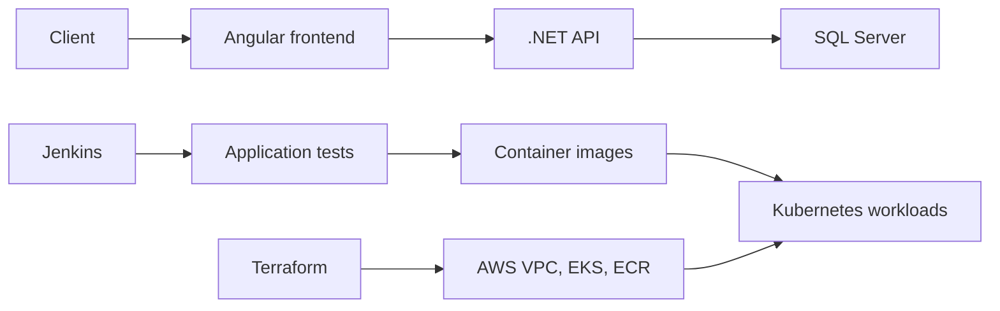

# MCIT DevOps Internship Project

[](https://aws.amazon.com/)
[](https://developer.hashicorp.com/terraform)
[](https://kubernetes.io/)
[](https://www.jenkins.io/)
[](https://ahmed-el-mahdy.github.io/)

A collaborative MCIT internship delivery of a three-tier application, covering application code, containers, tests, Kubernetes manifests, Jenkins automation, Ansible, and AWS infrastructure as code.


## What This Repository Demonstrates

- Angular client, .NET 8 API, SQL Server persistence, and automated tests in one delivery repository.
- Local container orchestration through Docker Compose.
- Kubernetes manifests for frontend, backend, SQL Server, ingress, configuration, secrets, and persistent storage.
- Terraform for AWS networking, EKS, ECR, bastion access, IAM, remote state storage, and state locking.
- Jenkins stages for dependency installation, tests, image builds, and registry publication.
- Ansible configuration for supporting EC2 hosts.

## Architecture



## Repository Map

| Path | Responsibility |
| --- | --- |
| `ClientSide` | Angular application and client tests |
| `ServerSide` | .NET solution, API, business/data layers, migrations, and tests |
| `docker-compose.yml` | Local frontend, API, and SQL Server stack |
| `k8s-manifets` | Kubernetes workload and networking resources |
| `terraform` | AWS VPC, EKS, ECR, IAM, bastion, and state resources |
| `Jenkinsfile` | Build, test, image build, and image push stages |
| `Ansible` | EC2 inventory and configuration playbook |

## Run the Application Locally

Docker Compose changes local container state and downloads several images:

```bash
git clone https://github.com/ahmed-el-mahdy/MCIT-DevOps-Project.git
cd MCIT-DevOps-Project
docker compose up --build
```

The Compose file exposes the client on port `80`, the API on port `8082`, and SQL Server on host port `1435`.

## Validate the Delivery Assets

Use read-only validation before any cloud deployment:

```bash
docker compose config
dotnet test ServerSide/WebApp.sln
kubectl apply --dry-run=client -f k8s-manifets/

cd terraform
terraform fmt -check -recursive
terraform init -backend=false
terraform validate
terraform plan
```

The Terraform plan can describe billable AWS resources. Review region, AMIs, network ranges, IAM permissions, and backend configuration before applying.

## Delivery Boundaries

- The Jenkinsfile builds and publishes images; Kubernetes deployment remains a separate operational step.
- The repository is a team project and this public copy is a fork. Collaborator links and Git history preserve that context.
- The Kubernetes folder name is intentionally retained as `k8s-manifets` to match the committed repository.
- Terraform provisions the EKS platform; the application database in the runtime manifests is SQL Server, not RDS MySQL.

## Security and Modernization Notes

- The Compose password is a local demonstration credential. Replace it with a secret manager or protected environment input outside local development.
- Replace Kubernetes placeholder secrets and `latest` image tags before deployment.
- Use workload identity or short-lived AWS credentials for CI/CD.
- Restrict bastion and security-group ingress to approved networks.
- Pin tool and image versions, add image scanning, and separate build from environment promotion for a production pipeline.

## Collaboration

This project was delivered with:

- [Ibrahim Mohamed Zaghloul](https://github.com/ibrahim-mohamed-zaghloul)
- [Michael Haleem](https://github.com/Michael-Haleem)
- [Mohamed Emad](https://github.com/Eng-Mohamed-Emad)
- [Ziad Abdelnasser](https://github.com/zabdeln4)

## Status

This repository is preserved as internship delivery evidence. It is suitable for architecture and CI/CD review, but the dated dependencies and demonstration credentials require modernization before production reuse.
